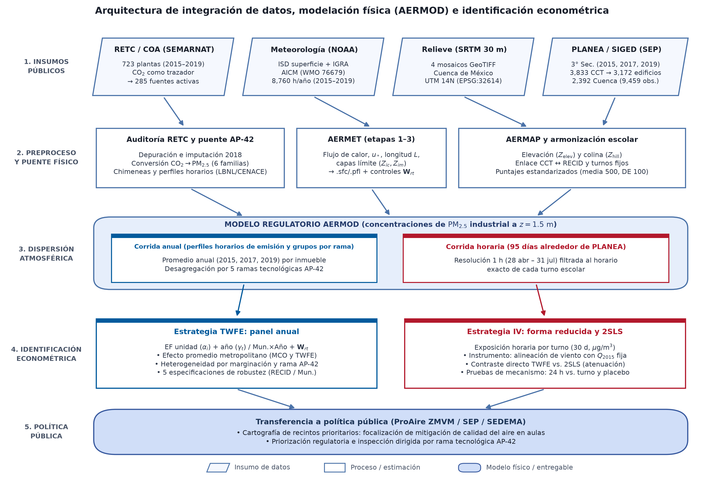

# Contaminación Industrial por PM2.5 y Desempeño Educativo en la ZMVM

Repositorio de investigación, modelación física de dispersión atmosférica (**AERMOD**) e identificación econométrica (**TWFE** y **2SLS**) sobre el impacto de las emisiones industriales de PM2.5 en el desempeño académico de escuelas secundarias en la Zona Metropolitana del Valle de México (2015–2019).

## Resumen de la Investigación

Las estimaciones convencionales del impacto de la contaminación del aire sobre el aprendizaje suelen depender de estaciones de monitoreo distantes o de radios geográficos simétricos que ignoran la física del transporte atmosférico. Este proyecto construye una medida hiperlocal de exposición a PM2.5 industrial a nivel de zona de respiración escolar (z = 1.5 m) para **3,172 recintos escolares** (3,833 CCTs evaluadas en **PLANEA 3° de Secundaria** en 2015, 2017 y 2019), integrando el inventario federal **RETC/COA** (285 fuentes fijas activas parametrizadas vía **US EPA AP-42**), relieve topográfico **SRTM** (`AERMAP`), meteorología de capa límite de la estación AICM (`AERMET`) y perfiles horarios de emisión (`EMISFACT MHRDOW` + despacho eléctrico **CENACE**).

A partir de las concentraciones simuladas —tanto en promedio anual por rama tecnológica como en resolución horaria/diaria (`POSTFILE`) filtrada al turno escolar— se estima el efecto sobre puntajes estandarizados de Matemáticas y Lenguaje mediante modelos de **Efectos Fijos Bidireccionales (TWFE)** y **Variables Instrumentales (2SLS)** explotando variaciones exógenas en la dirección del viento con emisiones fijas en 2015.

## Arquitectura Metodológica

## Estructura del Repositorio

    thesis-cdmx-air/
    ├── 00-onboarding-aermod/        # Kit de onboarding del laboratorio (AERMOD v24142)
    │   ├── README.md                # Inicio rápido (5 min)
    │   ├── RUNBOOK.md               # Runbook operativo completo (EMISFACT y POSTFILE)
    │   ├── install_aermod.sh        # Compilación nativa con gfortran (macOS / Linux)
    │   ├── environment.yml          # Entorno Conda reproducible (aermod-lab)
    │   ├── TEMPLATE_aermod.inp      # Plantilla maestra comentada
    │   ├── TROUBLESHOOTING.md       # Glosario de errores comunes en Fortran/AERMOD
    │   ├── DATA_DICTIONARY.md       # Fuentes públicas para replicar en otras ciudades
    │   └── toy_case/                # Caso de prueba autocontenido (~2 segundos)
    ├── 01-literature-tesina/        # Referencias y documentación bibliográfica
    ├── 02-data/                     # Datos crudos y procesados (solo estructura vía .gitkeep)
    │   ├── raw/                     # RETC, PLANEA, SIGED, meteorología, CENACE, curvas industriales
    │   └── processed/               # Salidas de AERMAP, AERMET, EMISFACT, DEMs y paneles
    ├── 03-analysis/                 # Pipeline de modelación física y análisis econométrico
    │   ├── README.md                # Guía de compilación nativa AERMOD/AERMAP/AERMET
    │   ├── pipeline_scripts/        # Scripts en Python para .so, .emi, .inp y paneles
    │   ├── aermod_bin/              # Binarios compilados (excluidos de Git)
    │   └── run_aermod*/             # Corridas aisladas (base, EMISFACT, POSTFILE 95d)
    ├── figuras_tesis/               # Figuras finales del documento y diagramas
    └── .gitignore                   # Exclusión de binarios, rasters y salidas masivas

## Reproducibilidad y Uso en el Laboratorio

Si llegas a este repositorio para replicar corridas de **AERMOD** en otro proyecto del laboratorio (sin licencias comerciales, en macOS Apple Silicon o Linux), empieza directamente en [`00-onboarding-aermod/README.md`](00-onboarding-aermod/README.md).

## Acceso a los Datos

Los insumos crudos y procesados (`02-data/`) no se versionan en Git por su tamaño, pero están disponibles bajo solicitud en Google Drive. Consulta las instrucciones y el enlace de solicitud en [`02-data/README.md`](02-data/README.md).
